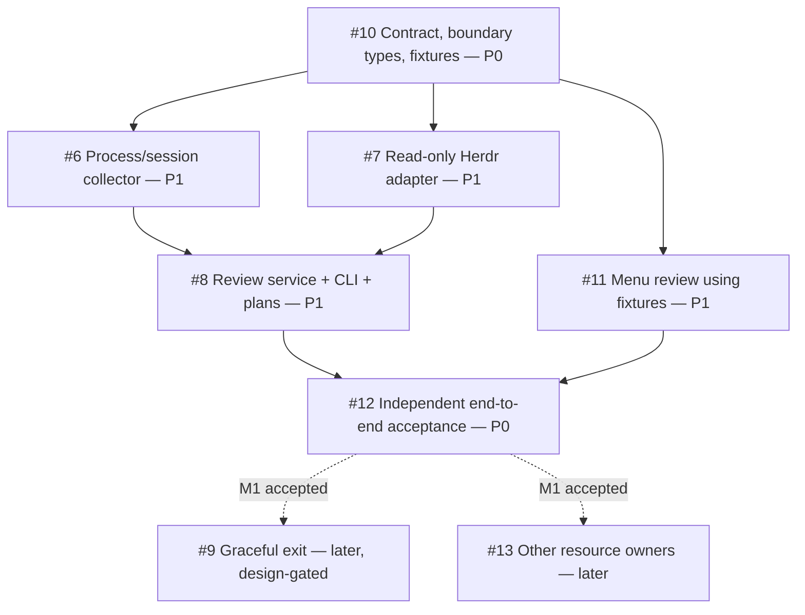

# M1: Read-only Herdr session review

## Outcome and boundary

A user can review scoped live terminal-agent sessions in the CLI and menu,
understand observations and exclusion reasons, select exact occupants, and
inspect a dry-run exit plan. Every plan reports `execution_supported=false`.
No agent is exited. The existing monitor-only deployment stays unchanged.
Read-only probes may start and cancel their own bounded helper subprocesses;
that does not authorize signaling existing user processes or sessions.

This is a useful first release: it turns pressure alerts into a reviewable list
instead of demanding that a user interpret dozens of process IDs. Graceful exit
is a later milestone, gated on this one's acceptance and additional exit-design
decisions. Browser/model/VM attribution is also follow-on work.

GitHub issue #4 is the parent product plan. Milestone 1 contains #10, #6, #7,
#8, #11 and #12. `milestone-1.tasks.json` is the dispatch graph; issue bodies
are the task acceptance specifications. Update both when dependencies change.

## Orchestrator startup

1. Read repository `AGENTS.md`, the engineering principles, this guide, and the
   issue body for the selected task. Use current CLI help/schema for implemented
   behavior. Proposed review commands do not exist until #8 lands.
2. Fetch the remote and inspect the current baseline, dirty worktree and host
   capabilities. Use a separate branch/worktree per implementation task. Keep
   private session inventories, cwd, resume references and screenshots outside
   this public repository.
3. Inspect merged dependency commits and their accepted SITREPs. A closed issue
   without its verified implementation is not a satisfied dependency. Dispatch
   only when every `depends_on` task has been accepted and merged.
4. Give each worker its issue URL, branch/base SHA, this guide, dependency
   contract/fixture commits, ownership boundary, and expected SITREP. Require
   it to state blockers rather than silently changing the contract or scope.
5. The first dispatch is #10 alone. Its output is a contract with executable
   validation, Go boundary types/provider interfaces, and sanitized fixtures.
   It is not a prose-only architecture document.

Completion of onboarding means the worker can name its input contract, exact
deliverable, allowed edits, verification scenarios, and acceptance owner.

## Dependency graph and scheduling



- **Wave 0:** #10, one contract owner. Accept and merge before parallel work.
- **Wave 1:** #6, #7, #11 can run concurrently. With four agent slots, this is
  one orchestrator plus three workers. Each uses the same frozen fixtures.
- **Wave 2:** #8 starts after #6 and #7 merge; #11 can continue independently.
- **Wave 3:** #12 starts after #8 and #11 merge. Prefer a reviewer who did not
  implement either feature. The orchestrator independently verifies its result.

P0 marks the next critical-path or acceptance work, not permission to ignore
dependencies. Priority never makes a blocked node dispatchable. #1 (legacy
tracker), #2 (CDP), #3 (swap alerts), and #5 (Finder/temp detection) are separate
workstreams and do not block M1. Do not fill idle swarm slots with them unless
the orchestrator explicitly expands its assigned scope.

Validate the static graph with `python3 scripts/validate-milestone-1.py`.
It checks dependency references, cycles, distinct ownership, the contract-first
root and the final acceptance gate. It does not claim that open dependencies
have been implemented; the orchestrator checks accepted merge commits.

## Work ownership and integration

| Issue | Owns | Uses without redefining |
|---|---|---|
| #10 | Shared review schemas, boundary types/interfaces, golden fixtures | Existing output and compatibility conventions |
| #6 | Process discovery, start identity, cwd, session/helper grouping, tests | Frozen process-provider interface |
| #7 | Herdr transport/normalization, capabilities, state/identity correlation, tests | Frozen Herdr-provider interface |
| #8 | Reconciliation, read-only worktree probes, review policy, CLI registration/output, tests | Both providers and frozen response/plan types |
| #11 | Swift review consumer/views, selection display, UI fixtures | CLI response/plan contract; no separate eligibility policy |
| #12 | Acceptance harness/evidence matrix, independent integration verification | All merged production paths |

The orchestrator serializes merges and owns integration conflicts. Contract
changes return to #10's owner for an explicit amendment; consumers update
against that accepted amendment. Do not give multiple workers ownership of CLI
registration, shared schemas, or the same output DTOs. Worker commits must be
traceable to their assigned issue; unrelated edits are reported separately.

## Domain rules for M1

- **Owner:** one positively identified terminal agent plus its helper process
  tree. Desktop helpers/app servers are not independent terminal sessions.
- **Identity:** a process PID plus actual OS start identity; a Herdr occupant
  also needs server/session scope, pane ID, and occupant revision. Deriving
  start identity from a moving `now - elapsed` estimate is insufficient.
- **Reviewable:** a fresh, positively correlated idle/done occupant that the
  user can assess. This does not mean abandoned, approved, or safe to exit.
- **Excluded:** working, blocked, unknown, stale, uncorrelated, or the current
  controlling agent. Exclusion reasons are visible and machine-readable.
- **Activity:** process age, conversation activity, and lifecycle observations
  are distinct facts with provenance. Missing facts stay unknown. A terminal
  redraw is not user activity. M1 does not require transcript ingestion.
- **Memory:** RSS is resident memory. Summed process RSS is an estimate, not
  unique physical RAM. Physical footprint, compressed and swap values may be
  unknown; M1 does not require additional OS memory probes.
- **Worktree state:** clean/dirty/unknown, captured read-only with a bounded
  probe. Review preserves files and the Git index, including untracked work.
- **Plan:** observations and selected exact identities with per-selection
  reasons, available recovery context, shell-preservation intent, and no
  execution capability. A changed occupant invalidates a prior selection.

Use an injectable clock. #10 fixes field names, null semantics, reason codes,
default five-second overall collection deadline, ordering, pagination, and
failure behavior before implementation. Optional probe failures return partial
results with warnings. Tests use recording fakes to prove zero control calls.

## Verification and host prerequisites

Go code uses the version declared by `go.mod`; real process discovery and the
Swift companion require macOS. Swift needs Xcode command-line tools. Typical
checks, scaled to the task, are:

```sh
GOCACHE=/tmp/perf-guard-go-cache go test ./...
GOCACHE=/tmp/perf-guard-go-cache go test -race ./...
GOCACHE=/tmp/perf-guard-go-cache go vet ./...
bash -n menubar/build.sh menubar/install.sh
GOCACHE=/tmp/perf-guard-go-cache bash menubar/build.sh
git diff --check
```

#10 must add and document the exact schema/fixture validation command. Record
it in every consumer's SITREP instead of assuming the schemas are valid.
Pure provider/reconciliation tests use fakes and sanitized fixtures; they must
not depend on a running Herdr instance or this owner's private sessions.

In a restricted agent sandbox, `ps` can fail even though the CLI runs. Report
that limitation; run pure tests and mark the real-host smoke blocked until a
suitable host is available. Never substitute zero sessions for denied access.
The final gate requires a real read-only smoke on a suitable Mac and UI visual
inspection; a successful compile does not satisfy either check.

Use an explicitly scoped Herdr endpoint or inherited caller context. Record
client/server versions separately. No fallback to a UI-focused session, server
restart, upgrade, new login item, or host installation is part of M1. Inspect
legacy test scripts before executing them; some perform live daemon/app work.
Use a fixture-backed view or an already authorized companion for visual QA.

For a fixture test of read-only worktree probes, assert repository files and
index bytes remain unchanged. For provider tests, assert an empty sequence of
input, close, signal, start, stop, update and install calls. Inspect production
adapter wiring too: fake-only tests cannot prove the real path is read-only.

## Worker SITREP

Return this report to the orchestrator with no private runtime data:

```text
Issue / branch / base SHA / head SHA:
Disposition: READY_FOR_REVIEW | NEEDS_REVISION | BLOCKED
Achieved: observable behavior and explicitly excluded scope.
Contract: version/commit consumed; amendments, if any.
Acceptance matrix:
  criterion -> test/command or artifact -> observed result
Checks: exact commands, exit codes, OS/tool versions, fixture vs real-host.
Artifacts: committed sanitized fixtures/tests; local private evidence location.
Side effects: recording-fake results and production-path inspection.
Integration: dependency SHAs, shared-file changes, conflicts/remaining work.
Limitations: failed/skipped checks, assumptions, host prerequisites.
Suggested next task:
```

An assertion such as "all tests pass" without commands, results and a tested
SHA is not a handback. Blocked host checks remain blocked. Fixture-only UI
completion can finish #11; it cannot finish #12 or the milestone.

## Orchestrator acceptance and closure

1. Inspect the worker diff and acceptance matrix, rerun the task's critical
   cases, and reject unproved criteria or scope expansion.
2. Merge accepted work one task at a time and rerun affected integration checks
   against the new combined tree. A worker's pre-merge SHA is not merged-tree
   evidence.
3. Close an implementation issue only after its accepted commit is merged and
   pushed, and record the accepted SHA/evidence on that issue. Update the parent
   checklist. Keep failed criteria open or file an explicit follow-up; do not
   silently waive milestone acceptance criteria.
4. #12 produces the complete fixture, real-host, UI and zero-side-effect matrix.
   The orchestrator independently checks it against the current merged SHA.
5. Close milestone 1 only when all six tasks are accepted, the final checks
   pass on that SHA, source is pushed, and Git reports the branch up to date.
   Closing M1 does not close parent #4, because #9 and broader attribution remain.

GitHub is the issue source of truth while #1 repairs the legacy Beads database
and hooks. The installed `bd` rejects the old `bd sync`/`bd hook` workflow. After
recording the manual quality gates, the documented temporary exception is
per-command `git -c core.hooksPath=/dev/null commit ...` / `push ...`; keep global
and repository hook settings unchanged. Do not run destructive tracker migration
or discard existing issue data as part of an unrelated implementation task.
